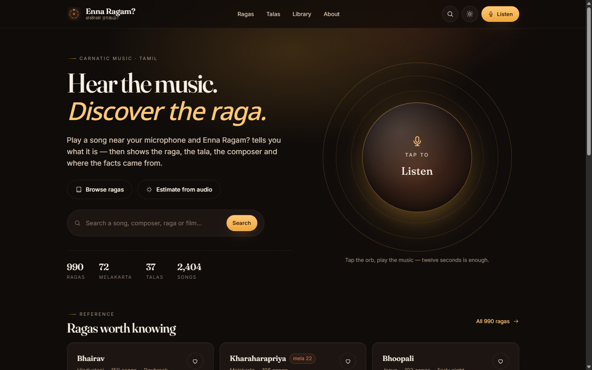

# Enna Ragam? — என்ன ராகம்?

**Hear the music. Discover the raga.**

**Live: https://nk12kumar.github.io/enna-ragam-preview/**

A Carnatic music discovery app: play a song near your microphone and Enna Ragam? identifies it, then shows the raga, tala, composer and the source for each fact.

This repository is the **static preview edition** of the app, published with GitHub Pages. It carries the complete music library — 990 ragas, 37 talas and 2,400 songs — bundled as JSON, so search, both explorers, song pages and the audio‑analysis pages all work with no server.

  

## What works in this static build

| Feature | Here | Self-hosted |
| --- | --- | --- |
| Song, composer, film and raga search | ✅ | ✅ |
| Raga explorer (72 melakarta + janya scales) | ✅ | ✅ |
| Tala explorer with playable anga cycles | ✅ | ✅ |
| Personal history and favourites (local storage) | ✅ | ✅ |
| On-device raga/tala estimation from a recorded clip | ✅ | ✅ |
| Live microphone song recognition (AudD) | ➖ needs the API | ✅ |

Live recognition is disabled here because the provider call must not ship an API token to a public page. The app says so plainly instead of pretending to listen.

## What makes it unusual

- **Sourced, not guessed.** Every raga scale, tala structure and song attribution is parsed from cited Wikipedia articles; each entry links to its source. When no source records a raga for a song, the field stays empty.
- **Predictions are labelled.** The audio-analysis modules (pitch tracking for ragas, onset analysis for talas) are heuristics, and the UI shows confidence and caveats next to every result.
- **Two sounds, one library.** Adi is 4 + 2 + 2 and you can hear it: each tala page plays its cycle, accenting the start of every anga.

## Install it

Open the live link in Chrome or Edge and use the install icon in the address bar. On iPhone or iPad, Share → Add to Home Screen. The app then runs offline with the bundled library.

## Source

The full app — Express 5 API, SQLite library, the Wikipedia data pipeline and the test suite — lives in the private repository `nk12Kumar/enna-ragam`. Setup, API surface and provenance notes are summarised in the hosted app's **About** page.

## Licences

- Music reference data: compiled from Wikipedia, CC BY-SA 4.0 (each record carries its article URL).
- Fonts: Fraunces, Inter, Noto Sans Tamil — SIL Open Font License.
- This build's application code: MIT (see `LICENSE`).

Built by [Neeraj Kumar N](https://github.com/nk12Kumar).
